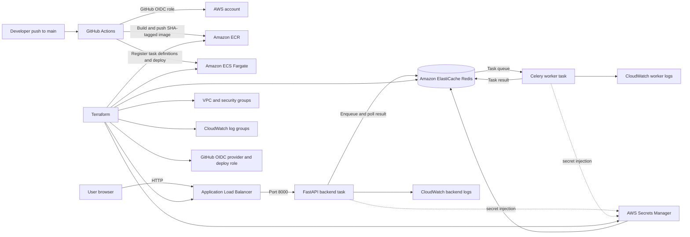

# Deployment Architecture

The ALB is public. Fargate tasks run in public subnets to avoid NAT Gateway cost for this assessment; their inbound security groups only allow backend traffic from the ALB, and the worker accepts no inbound traffic. ElastiCache uses private subnets, encryption in transit and at rest, and a generated AUTH token stored in Secrets Manager.
