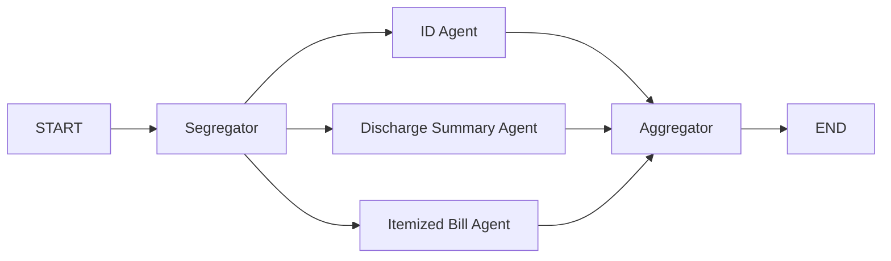

# Claim Processing API

Standalone FastAPI service implementing the claim PDF processing assignment. It accepts a PDF, classifies every page into one of nine document categories, runs three page-scoped extraction agents, and returns their aggregated JSON.

## Run

From the repository root, add an approved OpenAI API key to `.env`:

```dotenv
OPENAI_API_KEY=...
OPENAI_MODEL=gpt-4o-mini
```

Then start with Docker Compose:

```sh
docker compose up --build claims-api
```

The service listens at <http://localhost:8001>; interactive API docs are at <http://localhost:8001/docs>. To run without Docker:

```sh
pip install -r requirements.txt
export OPENAI_API_KEY="your-key"
uvicorn claims_pipeline.main:app --reload --port 8001
```

## Request

`POST /api/process` accepts `multipart/form-data` with these fields:

- `claim_id`: string, required
- `file`: PDF file, required

Example:

```sh
curl -X POST http://localhost:8001/api/process \
  -F 'claim_id=CLM-1001' \
  -F 'file=@./claim.pdf;type=application/pdf'
```

The response contains the claim ID, page classifications, identity and policy information, discharge summary fields, itemized bill lines, and the calculated sum of line amounts. Invalid, encrypted, oversized, empty, or textless PDFs receive a clear HTTP error. The default limits are 20 MiB and 100 pages, configurable with `MAX_PDF_BYTES` and `MAX_PDF_PAGES`.

## Graph



The segregator labels every page as one of `claim_forms`, `cheque_or_bank_details`, `identity_document`, `itemized_bill`, `discharge_summary`, `prescription`, `investigation_report`, `cash_receipt`, or `other`. LangGraph `Send` inputs give each extraction agent only its matching page text. The three agents run as parallel graph branches; the aggregator waits for all three and returns the combined response. Bill totals are calculated in application code from extracted line amounts rather than trusted to model arithmetic.

## Validation and data handling

Run the mock-model workflow test without an API key:

```sh
python -m unittest discover -s tests -v
```

Scanned/image-only PDFs require OCR before submission; OCR is not included. Claim text is sent to the configured OpenAI API. Do not send real personal/medical data unless you have authorization and the provider/account is approved for that data.